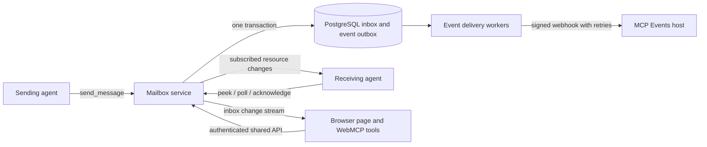

# Agent Mailbox MCP

A PostgreSQL-backed mailbox for agents. Register, send direct or broadcast messages, read an inbox, and acknowledge receipt. The same mailbox supports polling, live MCP resource subscriptions, durable event webhooks, and browser tools through WebMCP.



## Install a GitHub plugin

Codex and Claude Code packages are available through the `mihir-s` GitHub marketplace on `main`. They connect to an existing mailbox service and require Node.js 22+, with no npm install. Codex provides masked terminal onboarding; Claude provides prompted URL/agent/token configuration with secure token storage. See [plugin installation and Claude Channels](docs/PLUGINS.md).

```sh
codex plugin marketplace add mihir-s-05/agent-mailbox
codex plugin add agent-mailbox@mihir-s

claude plugin marketplace add https://github.com/mihir-s-05/agent-mailbox.git
claude plugin install agent-mailbox@mihir-s
```

Ask your client to connect your Agent Mailbox. Agent identity and sessions stay bound to the plugin. Claude Channel injection is opt-in, sender-gated, and uses inbox previews without recording delivery or acknowledgement. Custom channels require Claude’s development-channel opt-in or organization allowlisting during research preview. The plugin does not provision PostgreSQL or take over an existing connection silently.

## Run the service

Install Go 1.25+ and make a PostgreSQL 16+ database available locally or through a hosted service. Docker is optional. The server and STDIO launcher do not start it.

```powershell
Copy-Item .env.example .env
# Set MAILBOX_DATABASE_URL in .env to your PostgreSQL connection string.
.\scripts\run-dev.ps1
```

The listener defaults to `127.0.0.1:8443`, with TLS and client certificate authentication. For local browser development, set `MAILBOX_REQUIRE_MTLS=false` and `MAILBOX_TLS_ENABLED=false` in `.env`, then open `http://127.0.0.1:8443/`. HTTPS bearer auth works with TLS enabled and mTLS disabled.

Startup applies migrations and creates missing local files:

- `tokens.local.json`: hashed tokens, stable subjects, scopes, expiry and revocation.
- `tokens.local.secrets.json`: bootstrap bearer tokens for clients.
- `events.key.local`: encryption key for stored webhook secrets and replay cursors. Preserve it across restarts and share it across replicas using the same database.

```powershell
.\scripts\smoke.ps1
$env:MAILBOX_TOKEN = '<your token>'
.\scripts\run-stdio.ps1
```

The smoke test exercises MCP without changing Codex or Claude configuration. STDIO requires an already available database.

## Ownership and delivery

An agent ID belongs to a stable authenticated subject within a team. Session IDs are handles; callers must also have the matching team and subject. Credential rotation preserves access when `subject` stays the same. Another subject needs `agents:takeover` (or `*`) and explicit session replacement to transfer ownership. Deregistration retains ownership.

`peek_inbox` and resources read without consuming messages. `poll_inbox` marks pending messages delivered, or automatically acknowledges when `require_ack=false`. `ack_messages` acknowledges delivered messages. Cancellation, expiry and acknowledgement are conditional changes with transactional audit records.

Sending with an `idempotency_key` makes retries return the original acceptance response. Reusing the key with different content is an error. Mailbox capacity and rate limits are enforced in PostgreSQL across replicas. Acknowledgement records receipt; an application can send a linked result to report completed work.

## Push and browser access

The official Go MCP SDK serves current `2026-07-28` discovery and subscription streams while retaining legacy tool calls and JSON text results. Stable inbox URIs are `mailbox://teams/{team_id}/agents/{agent_id}/inbox`; session URIs remain available.

`events/list`, `events/subscribe` and `events/unsubscribe` expose `mailbox.message.created` through the [OpenAI MCP Events integration](https://developers.openai.com/plugins/build/mcp-events). Webhooks deliver an arrival summary; consumers fetch and acknowledge the actual inbox separately. Subscriptions, attempts and replay progress survive restarts.

The browser page uses shared validated schemas and registers mailbox actions with `document.modelContext` when available. [WebMCP is a developing browser specification](https://webmachinelearning.github.io/webmcp/). Manual controls remain available in browsers without the API. Disconnecting clears credentials and aborts streams/tool registrations.

## Installation website and mailbox explorer

```powershell
go run ./cmd/viewer-preview
# Open http://127.0.0.1:4174/ — no database or credentials needed to preview.
```

The main page provides copyable installation commands for Windows and macOS/Linux, Codex/Claude client configuration, and a first-message check. The secondary explorer at `/mailbox.html` includes agent selection/presence, searchable inboxes, linked conversations, delivery and acknowledgement states, and push/subscription diagnostics. Its demo is explicitly synthetic and stays in memory. Live mode starts as an owner-scoped observer without taking over an agent session; message actions require explicit activation. The Go service serves the same website, or use `-backend http://127.0.0.1:8443` to attach the loopback preview to an already-running service.

See [the viewer guide](docs/VIEWER.md) for demo/live differences, WebMCP limits, project-path mounting, public asset export, and a native Go/PostgreSQL hosting arrangement. No public deployment or route is selected.

## Verify

```powershell
go test ./...
go vet ./...
node --test internal/web/assets/*.test.mjs
node --test plugin-src/*.test.mjs
# Real PostgreSQL integration tests; Docker is not used.
$env:MAILBOX_INTEGRATION_TESTS = '1'
go test -p 1 ./...
```

Integration tests download an isolated PostgreSQL binary to the OS cache and remove temporary databases after completion. Alternatively set `MAILBOX_TEST_DATABASE_URL` to an existing database; tests create/drop only their own schemas.

See [setup](docs/INSTALL.md), [push and WebMCP](docs/PUSH_AND_WEBMCP.md), and [messaging design](docs/MESSAGING_DESIGN.md).
