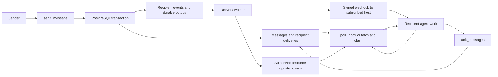

# Agent Mailbox: repository review and push inbox design

Reviewed on October 9, 2026, against commit `f182145` and the installed dependencies. This document records an assessment and proposed design; it does not implement the changes.

Implementation follow-up: the working tree now includes ownership enforcement, transactional delivery fixes, durable webhook events, current MCP transport support and a browser/WebMCP adapter. This review remains a record of the original state; see [current contracts](PUSH_AND_WEBMCP.md), [setup](INSTALL.md) and [messaging choices](MESSAGING_DESIGN.md) for the implemented behavior.

## Recommendation

Keep the PostgreSQL inbox and add durable event delivery around it. The existing message/delivery split is a useful foundation for a mailbox that supports both polling and subscriptions. PostgreSQL notifications should accelerate delivery; persisted records should determine what must still be delivered after a disconnect or restart.

There are two separate product outcomes:

- A connected client learns that its inbox changed and fetches messages.
- An agent host receives an event and starts work in response.

The server can support both. Whether an event actually starts a model turn also depends on the host. The OpenAI integration linked below establishes one supported host path; it does not establish equivalent behavior in local Codex or Claude Code.

## How the repository works today

The repository has four commands:

| Command | Responsibility |
| --- | --- |
| `cmd/agent-mailbox` | Authenticated Streamable HTTP MCP endpoint, health endpoint, notification listener, and background sweeps. |
| `cmd/agent-mailbox-stdio` | Client-launched MCP subprocess sharing the same PostgreSQL schema; authenticates through `MAILBOX_TOKEN`. |
| `cmd/migrate` | Applies ordered SQL migrations. |
| `cmd/mcp-call` | Small HTTP JSON-RPC caller used by the smoke script. |

`internal/config` loads limits, connection settings, and token records. Bootstrap generates random bearer tokens, keeps their hashes in the server file, and writes a separate secrets file for client setup. `internal/auth` checks bearer tokens, expiry, revocation, and optional client certificates; HTTP requests receive an authenticated principal through context. STDIO resolves its configured token on each operation.

`internal/mcpserver` exposes nine tools: register, send, poll, acknowledge, list agents, deregister, cancel, set status, and read the event log. It also exposes ordinary and urgent inbox resource templates. Most business logic and SQL live in the 1,458-line `internal/service/service.go`; `internal/store` handles pool creation and migrations rather than the mailbox queries themselves.

The database separates:

- `agents`: stable team/agent identity, tags, capabilities, presence, and status.
- `sessions`: explicit application handles, including the principal that registered them. A partial unique index allows one active session per team/agent.
- `messages`: immutable message data, routing, priority, expiry, reply pointer, acknowledgement policy, and send idempotency key.
- `deliveries`: one row per resolved recipient, with pending/delivered/acknowledged/expired/cancelled state.
- `message_events`: audit records for lifecycle transitions.

Registration creates or updates an agent and issues an application `session_id`. Direct sends can address registered offline agents. Broadcasts resolve the current registered team/tag membership, including offline members; they do not act as persistent topics for agents registered later. Message creation, initial audit logging, and recipient deliveries share a transaction.

Polling orders outstanding messages by descending priority, then ascending creation time and message ID. It uses a snapshot cutoff and a keyset cursor, caps pages at 100 messages, and supports a wait of up to 25 seconds. Messages requiring acknowledgement move to `DELIVERED` on polling and remain eligible for subsequent polls until acknowledged. Messages without that requirement are automatically acknowledged during polling. Reading an inbox resource calls `PeekInbox`, which reads up to 20 outstanding messages without changing delivery state, but its session validation still updates agent presence.

The notifier holds a PostgreSQL LISTEN connection and channels that wake long polls for a particular team/agent. When the listener is unavailable, polling queries periodically. In addition, the send path directly broadcasts MCP resource notifications through its local server instance. These are two separate notification paths.

## MCP compatibility and the OpenAI integration

The installed `mark3labs/mcp-go v0.44.0` identifies `2025-11-25` as its latest supported MCP revision. A direct probe confirmed that this mailbox does not implement `server/discover`, `subscriptions/listen`, or the event RPCs.

The current core protocol uses self-contained requests. HTTP carries protocol metadata and routing headers; `server/discover` reports capabilities and versions. Application handles remain valid architectural choices even though transport sessions have been removed. The mailbox's `session_id` is such an application handle and need not disappear. See the [MCP discovery specification](https://modelcontextprotocol.io/specification/2026-07-28/server/discover), [HTTP binding](https://modelcontextprotocol.io/specification/2026-07-28/basic/transports/streamable-http), and [versioning rules](https://modelcontextprotocol.io/specification/2026-07-28/basic/versioning).

Core `subscriptions/listen` delivers opted-in resource/catalog notifications, with acknowledgement and correlation metadata. It replaces older resource-subscription RPCs and HTTP GET listening. It informs a client about changes; model scheduling is a host decision. See the [subscription specification](https://modelcontextprotocol.io/specification/2026-07-28/basic/patterns/subscriptions) and the [older resource specification](https://modelcontextprotocol.io/specification/2025-11-25/server/resources).

OpenAI's documented event path requires MCP `2026-07-28`, `capabilities.events`, and `events/list`, `events/subscribe`, and `events/unsubscribe`. It uses verified HTTPS webhooks, persistent subscriptions, and outbound HTTPS. It is available in ChatGPT Work web chats, desktop Work with Cloud, and dots; event polling/streaming is unsupported there. Payloads are limited to 256 KiB. Webhook `2xx` confirms receipt, with processing asynchronous; `410` and `413` are non-retryable. Callback verification and delivery must block non-public destinations and redirects. These are integration requirements from the [OpenAI MCP events guide](https://developers.openai.com/plugins/build/mcp-events).

The underlying events proposal is still a draft and also describes event polling and streams, distinct from core resource-change subscriptions. It defines filter/payload schemas, stable occurrence IDs, replay cursors, TTLs, and idempotent subscription identity based on principal, callback, event name, and canonical arguments. See the [MCP Events design sketch](https://github.com/modelcontextprotocol/experimental-ext-triggers-events/blob/main/docs/design-sketch-proposal.md). Its current callback error allocation differs from the OpenAI guide (`-32027` versus `-32015`), so pin and test the intended integration contract instead of blindly following a changing draft.

The [official Go SDK compatibility table](https://github.com/modelcontextprotocol/go-sdk#version-compatibility) lists `v1.7.0+` support for `2026-07-28` and older revisions. It is a concrete migration candidate. This establishes core protocol support, not automatic support for the draft event extension; inspect extension hooks and event dispatch before selecting the adapter.

## Findings to address before push delivery

The protocol findings below were exercised without a database. SQL and concurrency findings were established through source inspection and still need PostgreSQL integration tests.

| Priority | Finding and consequence | Evidence and proposed change |
| --- | --- | --- |
| First | Session ownership is stored but never enforced. A same-team token with a known session handle can act through another principal's session. Registration also permits replacing another agent's session and exposes its handle in a conflict response. | `internal/service/service.go:129`, `:175`, `:1026`. Pass the principal to common session authorization, enforce ownership before presence updates, persist agent ownership across session rotation, and add explicit administrative takeover permission. If all team tokens intentionally share ownership, document that policy and rename `poll:self` accordingly. |
| First | The server advertises resource subscriptions but rejects subscription RPCs. | `internal/mcpserver/server.go:23`; probe returned `-32601` for `resources/subscribe` and `resources/unsubscribe`. Implement the appropriate protocol handlers or stop advertising the capability. |
| First | Resource notifications go to every initialized transport client and expose another mailbox's application session handle. This compounds the ownership gap. | `internal/service/notifier.go:96`. The probe registered two clients and both received both inbox URIs without subscriptions. Route only to authorized subscribers; use stable mailbox identity rather than an authorization handle in notifications. |
| First | Delivery state can be overwritten using stale reads. Poll transitions do not require the row still be pending and ignore update errors; acknowledgements read state and later update without a state predicate or row lock. | `internal/service/service.go:637`, `:1352`, `:1366`. Concurrent polling, acknowledgement, cancellation, or expiry can overwrite terminal states or create duplicate audit events. Use conditional `UPDATE ... RETURNING` in the same transaction as audit logging; report only committed transitions. |
| First | Send idempotency has a broken race path and can reject successful retries when an inbox fills. | `internal/service/service.go:291`, `:334`. Capacity/rate checks precede deduplication. After an insert uniqueness error, the lookup uses an already aborted transaction. Use conflict-safe insertion or a savepoint/rollback lookup, return the original acceptance time, and compare payload fingerprints when a key is reused. |
| First | Notifications occur after message commit and errors are ignored. A crash can leave a durable message without its wakeup; no subscription-delivery queue exists. | `internal/service/service.go:374`. Persist recipient events/outbox work with message creation; use transactional `pg_notify` and periodic reconciliation. |
| Next | Cross-process notifications wake long polls but do not forward MCP resource notifications. | `internal/service/notifier.go:181` and `internal/service/service.go:390`. Separate STDIO processes or HTTP instances do not receive the sender's in-process notification broadcast. Publish through each recipient-serving process after observing committed changes, with reconciliation after listener reconnect. |
| Next | Expiry audit writes execute while result rows hold the same transaction connection busy, and their errors are discarded. | `internal/service/service.go:982`. Collect/close rows and check `rows.Err()` before writing, or use an update/insert CTE. The installed pgx connection lock explicitly rejects concurrent use with `conn busy`. |
| Next | Capacity checking and insertion are separate transactions. Multiple senders can exceed the configured mailbox cap. | `internal/service/service.go:1286`. Enforce recipient capacity atomically, with deterministic lock order for broadcasts. Count live outstanding deliveries rather than relying solely on a delayed expiry sweep. |
| Next | Several row loops never check `rows.Err()`; audit retention is absent. | `PeekInbox`, `ListAgents`, `GetMessageLog`, recipient resolution, polling, and capacity queries; `SweepRetention` deletes deliveries/messages only. Surface iteration errors and define bounded, separate audit/event retention. |
| Next | Successful MCP text content is only `ok`. Consumers using text content cannot recover the message/session payload. | `internal/mcpserver/server.go:221`. Include serialized JSON alongside structured results and define output schemas. Tighten integer, routing, attachment, and enum schemas instead of silently coercing malformed input. |

Additional operational improvements:

- Add service/store integration tests and a protocol contract suite; current Go tests cover authentication, configuration, and model helpers only.
- Add readiness checks for PostgreSQL and delivery-worker progress; `/healthz` currently always returns success.
- Default explicitly to a loopback bind for local deployment. `:8443` binds all interfaces, despite localhost-oriented logs.
- Make public HTTPS transport and mandatory client-certificate policy independently configurable for cloud use. The existing mTLS/static-token deployment needs an explicit cloud-access/authentication design.
- Bound request size, attachment metadata, concurrent long polls, subscription count, and worker queues. Recheck authorization during long-lived delivery, including revocation.
- Add migration locking for concurrent HTTP/STDIO startup, and coordinate cleanup jobs across processes.
- Separate agent presence from subscription lifetime. An idle push subscriber should not need frequent mailbox polling just to remain online; conversely, a live subscription does not prove an agent is actively processing work.
- Make read-receipt behavior explicit. The receipt mode is validated/stored, but there is no receipt-routing implementation; audit events alone should not be presented as sender-facing receipts.
- Split mailbox operations, recipient resolution, state transitions, and event publication into smaller modules with typed results, while sharing startup/lifecycle code between HTTP and STDIO commands.
- Improve the smoke test to assert the sent message ID and acknowledgement result. Its non-mTLS path edits global Codex/Claude configuration; make client installation a separate opt-in script. Correct the installation guide's Go 1.22 prerequisite to match `go.mod`'s Go 1.25 requirement and document the certificate-generation dependency.

## Proposed push inbox

This is a proposed architecture, not a claim that all clients support every branch.

Start with a recipient-scoped `mailbox.message.created` event. Proposed filters are stable `agent_id`, minimum priority, and optional topic; derive the team from the authenticated principal. Event data should contain `message_id`, recipient, sender, priority, topic, expiry, and an optional bounded preview. Do not put application session handles in event data. For broadcasts, materialize recipient events using the recipients resolved by the send transaction.

The first implementation should push an arrival hint. The awakened agent registers/resumes its authorized mailbox handle if necessary, drains `poll_inbox`, performs the work, and acknowledges it. That reuses the existing delivery lifecycle and makes the inbox available for recovery. The event does not remove the message.

A later `get_message`/`claim_message` operation can fetch a particular event's message without draining unrelated messages. If multiple workers must process one mailbox, use a lease/visibility timeout and an acknowledgement token tied to the claim. Keep read-only inspection distinct from claiming work. Pure payload delivery also needs an explicit transition contract: current `ack_messages` rejects `PENDING` rows, so receiving a webhook alone cannot currently complete a message.

Keep three states separate:

1. Event queued for a subscription.
2. Event accepted by its callback or emitted on its stream.
3. Mailbox work acknowledged by its recipient.

The worker should durably claim jobs with a lease, deliver outside its database transaction, record acceptance, and retry transient failure with bounded backoff and jitter. A crash between callback acceptance and recording acceptance can produce a duplicate; stable event IDs and idempotent recipient actions handle that case. No exactly-once claim is warranted.

Use PostgreSQL first; a separate broker is unnecessary for the initial scope. Proposed tables are:

| Table | Purpose |
| --- | --- |
| `mailbox_events` | Immutable, recipient-scoped occurrences and replay positions. Existing audit rows can inform this design but lack a complete publication contract. |
| `event_subscriptions` | Owner, mailbox, event type, canonical filters, callback, protected signing secret, verification state, and granted expiry. |
| `event_deliveries` | Unique subscription/event pair, attempts, next attempt, lease, acceptance time, and last categorized error. |

Choose a replay cursor separate from the existing priority/snapshot inbox cursor. A cursor must represent recoverable event progress, with no advancement past outstanding lower positions. Sequence allocation and ULID order alone do not establish commit order: concurrent transactions can commit out of order. Use serialized publication per mailbox/subscription or a gap-aware progress scheme, and test reconnect during concurrent sends. Establish replay retention and explicitly signal unavailable history.

For webhook authentication, use the [Standard Webhooks specification](https://github.com/standard-webhooks/standard-webhooks/blob/main/spec/standard-webhooks.md): HMAC-SHA256 with the decoded signing key over the event ID, signing timestamp, and exact serialized body. Preserve event identity across retries, refresh the signing timestamp, and protect signing secrets at rest. Implement verification and destination validation before activating a subscription. Add delivery metrics and administrative inspection/redrive, without logging message bodies or secrets.

Add acknowledgement/cancellation/status events only after the arrival path is reliable. These can provide sender-facing receipts and coordination, but should not trigger work by default. Track causation and avoid creating automated reply or receipt loops.

## Implementation order and validation

1. Fix ownership, capability advertising, state transitions, expiry auditing, and send idempotency. Add real PostgreSQL concurrency tests for each failure mode.
2. Isolate the protocol adapter and migrate it to a verified `2026-07-28` implementation with legacy compatibility where needed. Preserve the existing application tool contract. Test metadata/header validation and resource subscription authorization.
3. Add committed recipient events, durable subscription/delivery storage, and a worker. Ensure reconciliation works even with missed PostgreSQL notifications.
4. Implement the OpenAI event adapter, callback verification, signing, refresh, unsubscribe, and revocation. Validate the full flow in a supported ChatGPT Work environment.
5. Add local resource streams or draft event streams only for clients whose support has been verified; otherwise retain long polling or provide a host-specific listener.

Acceptance scenarios should include offline recovery, callback timeout, duplicate acceptance after a worker crash, expiry/refresh after restart, cancellation racing with polling, concurrent duplicate sends, key reuse with different data, unauthorized mailbox/subscription access, burst backpressure, replay gaps, secret rotation, and unsubscribe/revocation during delivery.

## Verification performed

- Read every tracked Go source/test file, SQL migration, script, and repository guide.
- `go test ./...`: passed.
- `go vet ./...`: passed.
- An isolated in-process protocol probe confirmed the advertised subscription capability, unsupported subscription/event/discovery methods, and indiscriminate notification fanout. Its temporary source was removed afterward.
- Docker's engine was unavailable and PostgreSQL was not reachable on localhost:5432. No live database, cloud subscription, or agent wakeup test was performed. The supplied smoke script was not run because it requires a live server and can modify client configuration.

Only this assessment document was added. Runtime code, dependencies, database state, credentials, and client configuration were not changed.
